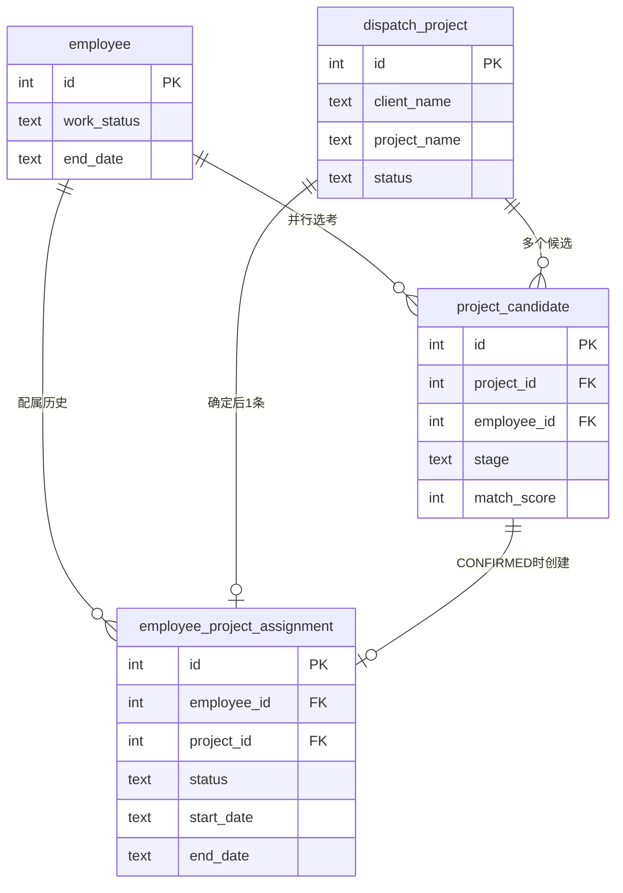
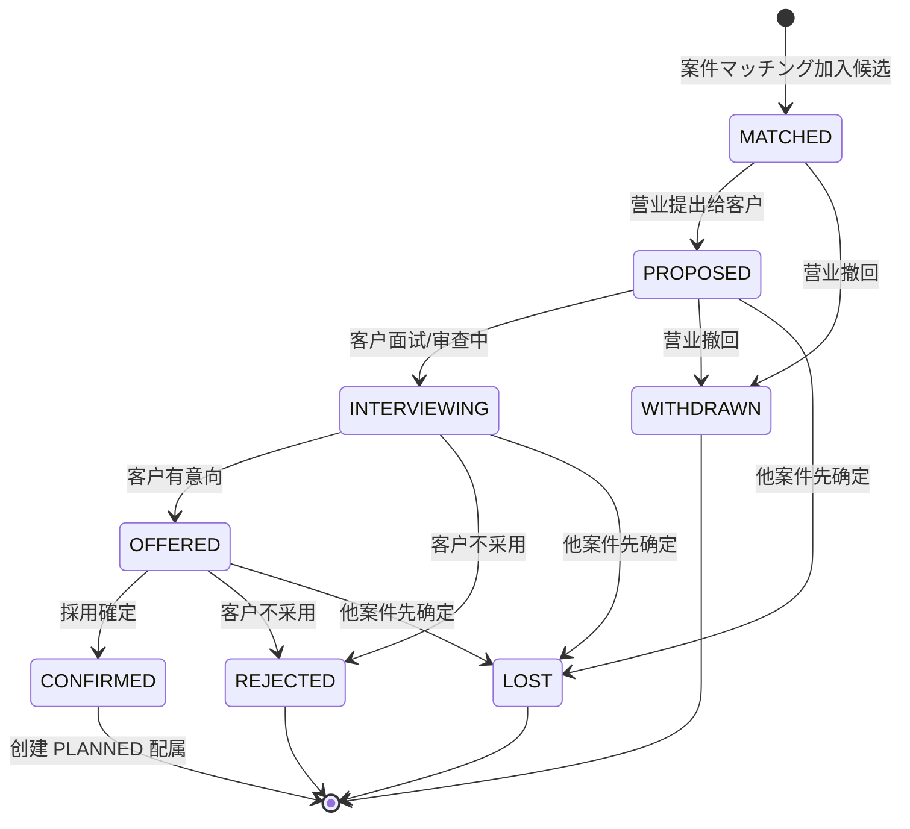
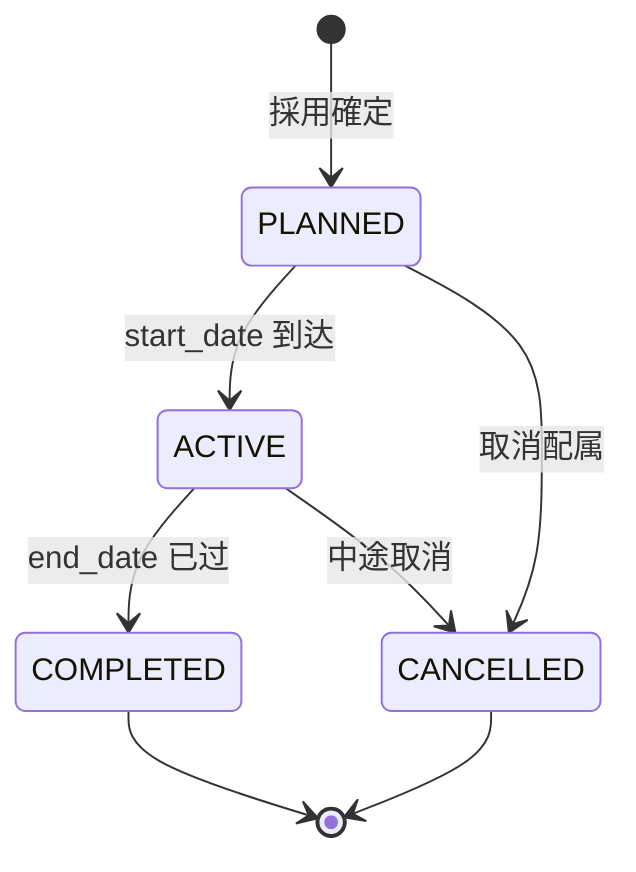
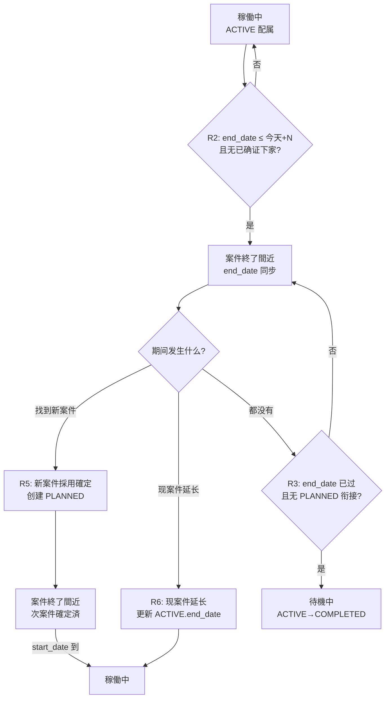
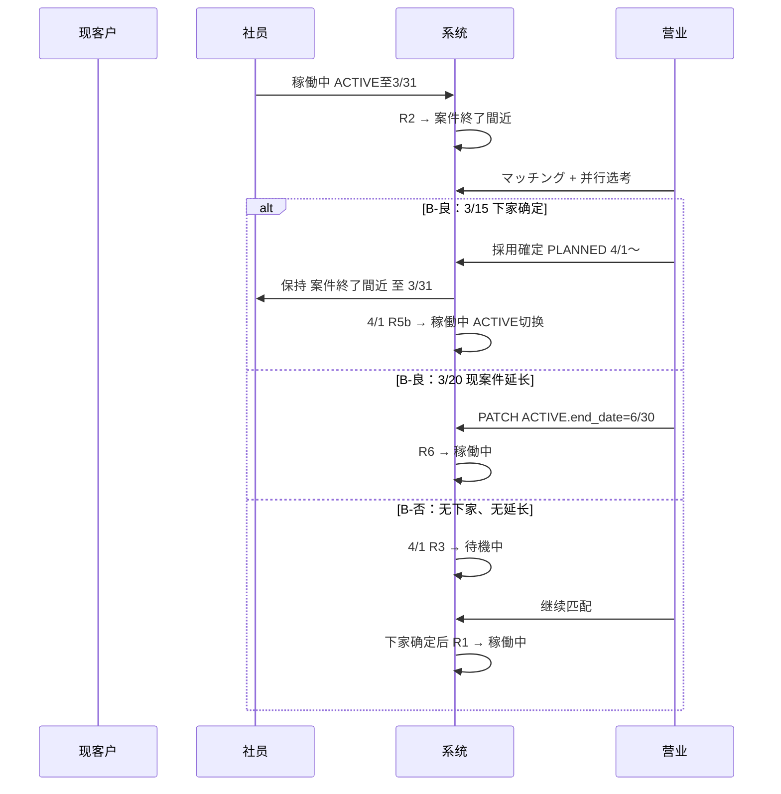

# 案件・选考・配属 设计书

> 社员情报管理系统 — 案件匹配后续流程与状态自动维护  
> 版本：v1.0（2026-05-24）

---

## 1. 背景与目标

### 1.1 现状

| 功能 | 现状 |
|------|------|
| 案件マッチング | 粘贴案件文本 → 技能匹配 → 显示适合度排序 |
| 社员状态 | `employee.work_status` 手动维护 |
| 项目结束日 | `employee.end_date`（仅 退職予定 / 案件終了間近 时使用） |
| 客户选考过程 | **未建模** |

### 1.2 业务要点（现场规则）

1. **匹配 ≠ 录用**：系统匹配只是内部参考，客户筛选后才会确定。
2. **并行选考**：一名技术者可同时参加多个客户的面试/审查。
3. **先定先得**：哪个客户先确定录用，就和哪个客户签约；其余进行中的选考应自动关闭。
4. **状态由配属驱动**：只有「採用確定 + 配属登记」才影响稼働状态，匹配结果本身不改变状态。

### 1.3 设计目标

- 结构化记录：案件 → 选考候选 → 配属确定
- 支持并行选考与互斥确定
- 定时任务基于 **CONFIRMED 配属** 建议/更新社员状态
- 与现有案件マッチング、一覧统计、权限体系兼容

---

## 2. 概念模型



### 2.1 三个核心实体

| 实体 | 含义 | 与现有系统关系 |
|------|------|----------------|
| `dispatch_project` | 营业手中的案件（需求方） | 新建；可从案件マッチング粘贴内容创建 |
| `project_candidate` | 某案件下的社员选考记录 | 新建；匹配结果「加入候选」写入此表 |
| `employee_project_assignment` | 客户确定后的正式配属 | 新建；**唯一驱动状态变更的业务对象** |

---

## 3. 数据库表结构

> 文件建议：`backend/src/main/resources/project-workflow-schema.sql`  
> 风格与 `event-participation-schema.sql` 一致（SQLite、TEXT 日期、`datetime('now','localtime')`）

### 3.1 dispatch_project（案件）

```sql
CREATE TABLE IF NOT EXISTS dispatch_project (
    id                  INTEGER PRIMARY KEY AUTOINCREMENT,
    client_name         TEXT NOT NULL,              -- 客户名
    project_name        TEXT NOT NULL,              -- 案件名
    project_text        TEXT,                       -- 原始需求文本（匹配用）
    required_skills     TEXT,                       -- JSON 或逗号分隔，可选
    work_location       TEXT,
    expected_start_date TEXT,                       -- 期望开始日
    expected_end_date   TEXT,                       -- 期望结束日
    headcount_required  INTEGER NOT NULL DEFAULT 1, -- 需求人数（≥1；已确认可多名）
    headcount_filled    INTEGER NOT NULL DEFAULT 0, -- 已採用確定人数（冗余，便于一覧）
    status              TEXT NOT NULL DEFAULT 'OPEN',
    -- OPEN | PARTIALLY_FILLED | FILLED | ON_HOLD | CLOSED | CANCELLED
    owner_user_id       INTEGER REFERENCES auth_user(id),
    notes               TEXT,
    created_at          TEXT NOT NULL DEFAULT (datetime('now','localtime')),
    updated_at          TEXT NOT NULL DEFAULT (datetime('now','localtime'))
);

CREATE INDEX IF NOT EXISTS idx_dispatch_project_client ON dispatch_project(client_name);
CREATE INDEX IF NOT EXISTS idx_dispatch_project_status ON dispatch_project(status);
CREATE INDEX IF NOT EXISTS idx_dispatch_project_start ON dispatch_project(expected_start_date);
```

### 3.2 project_candidate（选考候选）

```sql
CREATE TABLE IF NOT EXISTS project_candidate (
    id                  INTEGER PRIMARY KEY AUTOINCREMENT,
    project_id          INTEGER NOT NULL REFERENCES dispatch_project(id) ON DELETE CASCADE,
    employee_id         INTEGER NOT NULL REFERENCES employee(id),
    stage               TEXT NOT NULL DEFAULT 'MATCHED',
    -- 见 §4.1 选考阶段
    match_score         INTEGER,                    -- 系统匹配分数（可选）
    matched_skills      TEXT,                       -- JSON，匹配时的技能快照
    proposed_at         TEXT,                       -- 提出给客户日
    interview_at        TEXT,                       -- 面试日（可选）
    confirmed_at        TEXT,                       -- 客户确定日
    closed_at           TEXT,                       -- 关闭日
    close_reason        TEXT,                       -- 见 §4.2 关闭理由
    notes               TEXT,
    created_by          INTEGER REFERENCES auth_user(id),
    created_at          TEXT NOT NULL DEFAULT (datetime('now','localtime')),
    updated_at          TEXT NOT NULL DEFAULT (datetime('now','localtime')),
    UNIQUE(project_id, employee_id)
);

CREATE INDEX IF NOT EXISTS idx_project_candidate_project ON project_candidate(project_id);
CREATE INDEX IF NOT EXISTS idx_project_candidate_employee ON project_candidate(employee_id);
CREATE INDEX IF NOT EXISTS idx_project_candidate_stage ON project_candidate(stage);
```

**约束说明**

- `(project_id, employee_id)` 唯一：同一案件不重复添加同一人。
- **不限制** `(employee_id)` 在多个 `project_id` 上并行存在（并行选考）。

### 3.3 employee_project_assignment（配属）

```sql
CREATE TABLE IF NOT EXISTS employee_project_assignment (
    id                  INTEGER PRIMARY KEY AUTOINCREMENT,
    employee_id         INTEGER NOT NULL REFERENCES employee(id),
    project_id          INTEGER NOT NULL REFERENCES dispatch_project(id),
    candidate_id        INTEGER REFERENCES project_candidate(id),
    client_name         TEXT NOT NULL,              -- 冗余，便于查询
    project_name        TEXT NOT NULL,
    status              TEXT NOT NULL DEFAULT 'PLANNED',
    -- PLANNED | ACTIVE | COMPLETED | CANCELLED
    start_date          TEXT NOT NULL,
    end_date            TEXT,
    is_primary          INTEGER NOT NULL DEFAULT 1, -- 1=主配属
    notes               TEXT,
    confirmed_by        INTEGER REFERENCES auth_user(id),
    confirmed_at        TEXT NOT NULL,
    created_at          TEXT NOT NULL DEFAULT (datetime('now','localtime')),
    updated_at          TEXT NOT NULL DEFAULT (datetime('now','localtime'))
);

CREATE INDEX IF NOT EXISTS idx_assignment_employee ON employee_project_assignment(employee_id);
CREATE INDEX IF NOT EXISTS idx_assignment_project ON employee_project_assignment(project_id);
CREATE INDEX IF NOT EXISTS idx_assignment_status ON employee_project_assignment(status);
CREATE INDEX IF NOT EXISTS idx_assignment_start ON employee_project_assignment(start_date);
CREATE INDEX IF NOT EXISTS idx_assignment_end ON employee_project_assignment(end_date);
```

**业务约束（应用层 enforce，非 DB UNIQUE）**

- 同一 `employee_id` 在任意时刻最多 **1 条** `status IN ('PLANNED','ACTIVE') AND is_primary = 1`。
- `CONFIRMED` 选考时创建 `PLANNED` 配属；`start_date` 到达后升为 `ACTIVE`。

### 3.4 employee_status_change_log（状态变更审计）

```sql
CREATE TABLE IF NOT EXISTS employee_status_change_log (
    id                  INTEGER PRIMARY KEY AUTOINCREMENT,
    employee_id         INTEGER NOT NULL REFERENCES employee(id),
    old_work_status     TEXT,
    new_work_status     TEXT NOT NULL,
    old_end_date        TEXT,
    new_end_date        TEXT,
    trigger_type        TEXT NOT NULL,
    -- MANUAL | SCHEDULED | CONFIRM_HIRE | ASSIGNMENT_START | ASSIGNMENT_END
    trigger_ref_id      INTEGER,                    -- assignment_id / candidate_id 等
    reason              TEXT NOT NULL,
    applied_by          INTEGER REFERENCES auth_user(id),  -- NULL=系统自动
    created_at          TEXT NOT NULL DEFAULT (datetime('now','localtime'))
);

CREATE INDEX IF NOT EXISTS idx_status_log_employee ON employee_status_change_log(employee_id);
CREATE INDEX IF NOT EXISTS idx_status_log_created ON employee_status_change_log(created_at);
```

### 3.5 employee_status_suggestion（待确认建议，可选）

初期建议模式（`auto-apply=false`）时使用：

```sql
CREATE TABLE IF NOT EXISTS employee_status_suggestion (
    id                  INTEGER PRIMARY KEY AUTOINCREMENT,
    employee_id         INTEGER NOT NULL REFERENCES employee(id),
    suggested_status    TEXT NOT NULL,
    suggested_end_date  TEXT,
    reason              TEXT NOT NULL,
    source_assignment_id INTEGER REFERENCES employee_project_assignment(id),
    status              TEXT NOT NULL DEFAULT 'PENDING',
    -- PENDING | APPLIED | DISMISSED
    created_at          TEXT NOT NULL DEFAULT (datetime('now','localtime')),
    resolved_at         TEXT,
    resolved_by         INTEGER REFERENCES auth_user(id)
);

CREATE INDEX IF NOT EXISTS idx_status_suggestion_pending ON employee_status_suggestion(status, employee_id);
```

---

## 4. 状态机

### 4.1 选考阶段 `project_candidate.stage`



| 阶段 | 日文标签（UI） | 是否占用「确定名额」 |
|------|----------------|----------------------|
| MATCHED | マッチング済 | 否 |
| PROPOSED | 顧客提案済 | 否 |
| INTERVIEWING | 選考中 | 否 |
| OFFERED | 内定待ち | 否 |
| CONFIRMED | 採用確定 | **是** |
| REJECTED | 不採用 | — |
| WITHDRAWN | 提案撤回 | — |
| LOST | 他案件確定 | — |

**进行中的 stage**（可被 LOST 批量关闭）：

`MATCHED`, `PROPOSED`, `INTERVIEWING`, `OFFERED`

### 4.2 关闭理由 `close_reason`

| 代码 | 说明 |
|------|------|
| `CLIENT_REJECTED` | 客户不采用 |
| `INTERNAL_WITHDRAW` | 营业撤回 |
| `OTHER_CANDIDATE_CONFIRMED` | 该社员在其他案件已确定（先定先得） |
| `EMPLOYEE_UNAVAILABLE` | 社员休职/退职等 |
| `PROJECT_CLOSED` | 案件本身关闭 |

### 4.3 配属状态 `employee_project_assignment.status`



### 4.4 社员稼働状态 `employee.work_status`（与配属联动）

现有值（`MasterData`）：

`稼働中` | `待機中` | `休職中` | `退職予定` | `退職` | `案件終了間近`

**不参与自动变更**：`休職中` | `退職予定` | `退職`

稼働生命周期由 **两条主线** 构成（互为衔接，不是同一起点）：

| 主线 | 路径 | 业务含义 |
|------|------|----------|
| **A：上项目** | 待機中 → 稼働中 | 下家确定 / 配属开始日到达 |
| **B：项目收尾** | 见下方 **B-良** / **B-否** 分叉 | 现项目快结束时的两种结局 |

**主线 B 的分叉（业务确认版）**

| 分支 | 路径 | 条件 |
|------|------|------|
| **B-良（续稼働）** | 稼働中 → 案件終了間近 → **稼働中** | 期间内 **找到新案件** 或 **现案件延长** |
| **B-否（待机）** | 稼働中 → 案件終了間近 → **待機中** | 现项目已结束，且 **无新案件、无延长** |

> **说明**：`待機中` 表示当前没有在跑的主项目，**不会**直接变为 `案件終了間近`。  
> 「项目马上结束」一定发生在 **仍在客户处稼働** 的阶段，因此进入 `案件終了間近` 前通常是 `稼働中`。

```mermaid
stateDiagram-v2
    direction LR
    state "主线 A" as flowA {
        待機中 --> 稼働中: R1 配属开始
    }
    state "主线 B" as flowB {
        稼働中 --> 案件終了間近: R2 将结束且无确证
        案件終了間近 --> 稼働中: R5b 换项目日\n或 R6 现案件延长
        案件終了間近 --> 待機中: R3 已结束且无后续
    }
    待機中 --> 稼働中: R1
```

**与选考/匹配的关系**

- **案件マッチング可搜出**：`待機中`，或 `案件終了間近` 且 **尚未** 有已确定的下家配属（无 PLANNED / 无 CONFIRMED 锁定）。
- **案件マッチング不可搜出**（业务确认）：採用確定后、换项目日之前——即使状态仍为 `案件終了間近`，也 **不再** 进入匹配候选池（下家已锁定）。
- **并行选考**：仅在 **未确定下家** 时允许；确定后其他进行中選考已在 §5.1 中 LOST，且不应再被加入新案件匹配。

> 实现：`ProjectMatchRepository` 在现有 `work_status` 条件上，增加 **排除「已有 PLANNED 主配属且 start_date > today」** 的社员（见 §6.5、§8）。

> **重要**：匹配、提案、面试 **均不直接** 改变 `work_status`；仅 **CONFIRMED 配属** 与 **定时规则 R1～R6** 驱动状态变更。

### 4.5 主线 B 详图：案件終了間近 的两种结局



| 阶段 | 社员在做什么 | 系统应做什么 |
|------|--------------|--------------|
| **稼働中** | 在现客户处正常工作 | 维护 ACTIVE 配属 |
| **案件終了間近** | 仍在现客户处工作，需找下家或等待延长 | 写入 `end_date`；开放匹配与选考 |
| **案件終了間近（次案件確定済）** | 现项目未结束，下家已 PLANNED | 保持状态；**不参与案件マッチング**；UI 显示次案件开始日 |
| **稼働中**（B-良） | 换项目日到达，或合约已延长 | R5b 换项目日 / R6 延长立即恢复 |
| **待機中**（B-否） | 现项目已结束，无下家、无延长 | ACTIVE→COMPLETED；清空 `end_date` |

---

## 5. 核心业务规则

### 5.1 採用確定（先定先得）— 事务内一次性执行

**触发**：营业对 `project_candidate` 执行「採用確定」。

**前置检查**

1. 该 candidate 的 `stage` 须为 `INTERVIEWING` 或 `OFFERED`（**方案 B**：選考中可直接確定，§12.1）。
2. 该 `employee_id` **不存在** 其他尚未 CANCELLED 的 PLANNED/ACTIVE 主配属（先定先得）。
3. 社员 `work_status` 不为 `退職` / `休職中`（可警告但不绝对禁止，由营业判断）。
4. 该案件 `headcount_filled < headcount_required`（多名需求时仍可继续確定，直至满员）。

**执行步骤**（同一 DB 事务）

```
1. UPDATE project_candidate SET stage='CONFIRMED', confirmed_at=now WHERE id=?
2. INSERT employee_project_assignment (status='PLANNED', start_date, end_date, ...)
3. UPDATE 该 employee 其他 project_candidate → LOST (OTHER_CANDIDATE_CONFIRMED)
4. headcount_filled += 1
   IF headcount_filled >= headcount_required → dispatch_project.status = 'FILLED'
   ELSE → status = 'PARTIALLY_FILLED'   -- 已确认：一名案件可多名社员
5. INSERT employee_status_change_log (trigger_type='CONFIRM_HIRE', ...)
6. 若社员为 案件終了間近 → 保持至换项目日；从マッチング排除（§5.7）
```

**竞态**：步骤 2 前再次 SELECT 检查是否已有 PLANNED/ACTIVE 主配属；若有则整事务回滚，返回「他案件で先に確定済み」。

### 5.2 并行选考展示规则

| 查询场景 | SQL 逻辑概要 |
|----------|--------------|
| 社员当前选考数 | `COUNT(*) WHERE employee_id=? AND stage IN (进行中)` |
| 案件候选一览 | `WHERE project_id=? ORDER BY stage, match_score DESC` |
| 能否再添加候选 | 允许；仅 `(project_id, employee_id)` 不可重复 |
| 能否再「採用確定」 | 该 employee 无其他 PLANNED/ACTIVE 主配属 |

### 5.3 定时任务 `EmployeeStatusMaintenanceService`

参考现有 `ClientEventStatusMaintenanceService` 模式：

```properties
app.employee-status.maintenance.enabled=true
app.employee-status.maintenance-cron=0 30 1 * * *
app.employee-status.ending-soon-days=30
app.employee-status.auto-apply=false
```

**规则 R1 — 配属开始**

```
IF employee.work_status = '待機中'
AND EXISTS assignment(status='PLANNED', is_primary=1, start_date <= today)
THEN suggest/apply → 稼働中
AND assignment.status → ACTIVE
```

**规则 R2 — 项目即将结束**

```
IF employee.work_status = '稼働中'
AND EXISTS assignment(status='ACTIVE', is_primary=1, end_date <= today + N days)
AND NOT EXISTS assignment(status='PLANNED', is_primary=1, start_date > today)
THEN suggest/apply → 案件終了間近
AND employee.end_date = ACTIVE.end_date
```

**规则 R3 — 项目已结束且无后续（B-否 终点）**

```
IF employee.work_status = '案件終了間近'   -- 仅当仍为「结束间近」、未走 B-良
AND ACTIVE 已结束 (end_date < today)
AND NOT EXISTS PLANNED 主配属 (start_date <= today 或已衔接)
THEN suggest/apply → 待機中, end_date = NULL
AND assignment(ACTIVE) → COMPLETED
```

**规则 R4 — PLANNED 配属到期自动激活**

```
IF assignment.status = 'PLANNED' AND start_date <= today
THEN assignment.status → ACTIVE
（若旧 ACTIVE 同日结束则 COMPLETED，并触发 R1 / R5b）
```

**规则 R5 — 案件終了間近 → 稼働中（B-良：找到新案件）**

**业务确认**：採用確定后 **保持 `案件終了間近` 直至换项目日**（PLANNED.start_date），当日再变为 `稼働中`。不采用「确定即恢复」。

**採用確定当时（社员为 案件終了間近）**

```
1. INSERT PLANNED 配属 (start_date, end_date)  -- §5.1
2. work_status 保持 '案件終了間近'
3. employee.end_date 保持现 ACTIVE.end_date
4. UI 显示「次案件 {start_date} 開始予定済」
5. 该社员从案件マッチング候选池排除（§5.7），直至 R5b 换项目日
6. INSERT log (trigger_type='CONFIRM_HIRE', ...)
```

**换项目日（规则 R5b，定时任务 start_date 当日）**

```
1. 旧 ACTIVE → COMPLETED（若 end_date < start_date 或同日切换）
2. PLANNED → ACTIVE
3. employee.work_status → '稼働中'
4. employee.end_date → NULL 或新 ACTIVE.end_date
5. INSERT log (trigger_type='ASSIGNMENT_START', ...)
宏观路径：稼働中 → 案件終了間近 → … → 稼働中（换项目日）✓
```

> 配置项 `app.employee-status.revert-on-confirm` 固定为 `false`（见 §10）。仅当未来业务要求「确定即恢复」时才设为 `true`。

**规则 R6 — 案件終了間近 → 稼働中（B-良：现案件延长）**

**触发**：营业更新 **当前 ACTIVE 配属** 的 `end_date` 为更晚日期（客户同意延长）。

**条件**

```
employee.work_status = '案件終了間近'
ACTIVE.end_date 更新为 new_end_date
AND new_end_date > today + N days   -- 重新超出「即将结束」阈值
```

**执行**

```
1. UPDATE assignment SET end_date = new_end_date
2. employee.work_status → '稼働中'
3. employee.end_date → NULL
4. INSERT log (trigger_type='ASSIGNMENT_EXTEND', reason='現案件延長により終了間近解除')
```

若延长后仍 within N 天（只延了一两周）：保持 `案件終了間近`，仅更新 `employee.end_date = new_end_date`。

**规则 R2 补充 — 有确证下家时跳过进入 案件終了間近**

若採用確定 **早于** R2 触发、且 PLANNED 已存在：永不进入 `案件終了間近`，保持 `稼働中` 直至换项目（场景 C）。

`auto-apply=false` 时：写入 `employee_status_suggestion`，不直接 UPDATE employee。

### 5.4 主线 A：待機中 → 稼働中（上项目）

**触发**：规则 R1 / R4，或採用確定时 `start_date ≤ 今天` 且当前为待機中。

**前置条件**

```
employee.work_status = '待機中'
EXISTS employee_project_assignment
  WHERE employee_id = ?
    AND status = 'PLANNED'
    AND is_primary = 1
    AND start_date <= today
```

**执行**

```
1. assignment(PLANNED) → ACTIVE
2. employee.work_status → '稼働中'
3. employee.end_date → NULL（若此前有残留）
4. INSERT employee_status_change_log (trigger_type='ASSIGNMENT_START', ...)
```

**与选考的关系**：进入稼働 **不关闭** 其他案件的进行中选考；但若已有 ACTIVE 主配属，通常不应再对 **另一客户** 做 CONFIRMED（业务上同一时间只服务一个主客户）。

---

### 5.5 主线 B：稼働中 → 案件終了間近 →（稼働中 | 待機中）

进入 `案件終了間近` 后，**只有两种出口**（业务确认）：

| 出口 | 路径 | 触发 |
|------|------|------|
| **B-良** | → **稼働中** | R5b 换项目日（新案件确定后），或 R6 现案件延长（立即） |
| **B-否** | → **待機中** | R3 现项目结束且仍未解决 |

#### 5.5.1 阶段 1：稼働中 → 案件終了間近（规则 R2）

**业务场景**：项目合约快到期的前 N 天（默认 30 天），营业需要为该社员寻找下一案件；本人 **仍在现客户处稼働**。

**触发条件**（全部满足）

```
employee.work_status = '稼働中'
EXISTS assignment A: status='ACTIVE', is_primary=1
  AND A.end_date IS NOT NULL
  AND A.end_date <= today + N days
NOT EXISTS assignment P: status='PLANNED', is_primary=1
  -- 尚未有「确证的下家」（採用確定后的 PLANNED）
```

**执行**

```
1. employee.work_status → '案件終了間近'
2. employee.end_date → ACTIVE.end_date
3. INSERT employee_status_change_log (...)
4. （可选）通知营业启动匹配
```

#### 5.5.2 阶段 2：案件終了間近期间 — 两条出路

**出路 ①：找到新案件（→ 换项目日才 稼働中，不经过待機中）**

```
营业：并行选考 → 某客户採用確定
系统：§5.1 创建 PLANNED
  → work_status 保持 '案件終了間近'
  → UI：「現案件 ～3/31 / 次案件 4/1 開始 確定済」
到 start_date（R5b）：→ '稼働中'；旧 ACTIVE→COMPLETED，新 PLANNED→ACTIVE
宏观路径：稼働中 → 案件終了間近 →（换项目日）→ 稼働中  ✓
```

**出路 ②：现案件延长（→ 稼働中，不经过待機中）**

```
营业：与客户协商延长，更新 ACTIVE.end_date
系统：R6
  IF new_end_date > today + N → '稼働中', end_date 清空
  ELSE → 保持 '案件終了間近', 仅更新 end_date 显示
宏观路径：稼働中 → 案件終了間近 → 稼働中  ✓
```

**出路 ③：都没有（→ 待機中）**

```
现项目 end_date 已过，无 PLANNED、无延长
系统：R3
  → ACTIVE COMPLETED, work_status '待機中'
宏观路径：稼働中 → 案件終了間近 → 待機中  ✓
```

**此阶段允许的操作**

| 动作 | 未确定下家 | 次案件確定済（换项目日前） |
|------|------------|---------------------------|
| 案件マッチング | ✅ | ❌ **不参与** |
| 加入其他案件选考 | ✅ | ❌ |
| 採用確定下家 | ✅ → 保持 案件終了間近，换项目日 R5b | —（已确定） |
| 更新现 ACTIVE.end_date（延长） | ✅ → R6 | ✅ → R6 |
| 手动改状态 | ❌ | ❌ |

#### 5.5.3 阶段 3：仅 B-否 到达 待機中（规则 R3）

**业务场景**：`案件終了間近` 期间 **既未确定新案件，也未延长**，且现项目 **已结束**。

**触发条件**

```
employee.work_status = '案件終了間近'
ACTIVE.end_date < today
NOT EXISTS PLANNED (start_date <= today 且可衔接)
NOT EXISTS 延长后的 ACTIVE 覆盖 today
```

**执行**

```
1. assignment(ACTIVE) → COMPLETED
2. employee.work_status → '待機中'
3. employee.end_date → NULL
4. INSERT log (trigger_type='ASSIGNMENT_END', ...)
```

之后进入主线 A，等待下家 `start_date` → R1 → 稼働中。

#### 5.5.4 主线 A 与 B 的衔接



---

### 5.7 案件マッチング 可搜出条件（业务确认）

社员出现在案件マッチング结果中，需 **同时** 满足：

```
1. work_status IN ('待機中', '案件終了間近')
2. work_status NOT IN ('休職中', '退職', '退職予定')  -- 既存
3. NOT EXISTS (
     employee_project_assignment
     WHERE employee_id = e.id
       AND status = 'PLANNED'
       AND is_primary = 1
       AND start_date > today    -- 已确定下家、尚未换项目
   )
4. （可选）NOT EXISTS (
     project_candidate
     WHERE employee_id = e.id
       AND stage = 'CONFIRMED'
       AND 尚无 PLANNED  -- 异常数据防护
   )
```

| 社员状态 | 是否有 PLANNED 下家（start_date > today） | マッチング |
|----------|-------------------------------------------|------------|
| 待機中 | 否 | ✅ 可搜出 |
| 待機中 | 是（未来配属已确定） | ❌ 不可搜出 |
| 案件終了間近 | 否 | ✅ 可搜出 |
| 案件終了間近 | 是（次案件確定済） | ❌ **不可搜出** |
| 稼働中 | — | ❌（既存：不在匹配范围） |

**採用確定事务（§5.1）追加**：创建 PLANNED 后，该社员自动从后续 `POST /api/project-match` 结果中消失，直至 R5b 换项目日变为 ACTIVE（若新案件仍在未来，换项目日后为 稼働中，亦不在匹配池）。

**UI 提示**（可选）：匹配页说明 —「次案件確定済の社員は、切替日までマッチング対象外です。」

---

### 5.8 与现有字段的关系

| 字段 | 用途 |
|------|------|
| `employee.work_status` | 当前稼働状态（自动+手动） |
| `employee.end_date` | 一覧「今月終了予定」等；**以 ACTIVE 主配属 `end_date` 为准**，R2/R6 时从配属同步写入 |
| `employee_hr.contract_end_date` | 人事合同，**暂不驱动** 案件配属状态（将来可关联校验） |

**end_date 同步规则（已确认）**

- 主数据：`employee_project_assignment`（ACTIVE / PLANNED）的 `start_date` / `end_date`。
- `employee.end_date` 为 **展示用冗余**；进入 `案件終了間近` 时写入 ACTIVE.end_date；恢复 `稼働中` 或 R6 延长后清空或再同步。
- 配属与 employee 不一致时，**以配属为准**，定时任务或保存配属时回写 employee。

---

## 6. API 设计概要

### 6.1 案件 CRUD

| Method | Path | 说明 |
|--------|------|------|
| GET | `/api/projects` | 案件一览（筛选 status/client） |
| POST | `/api/projects` | 新建（可从匹配页带入 project_text） |
| GET | `/api/projects/{id}` | 详情含候选列表 |
| PUT | `/api/projects/{id}` | 更新 |
| PATCH | `/api/projects/{id}/status` | 关闭/保留等 |

### 6.2 选考候选

| Method | Path | 说明 |
|--------|------|------|
| POST | `/api/projects/{id}/candidates` | 添加候选 `{ employeeId, matchScore?, matchedSkills? }` |
| GET | `/api/projects/{id}/candidates` | 案件下候选一览 |
| GET | `/api/employees/{id}/candidates` | 社员并行选考一览 |
| PATCH | `/api/candidates/{id}/stage` | 推进阶段 `{ stage, notes? }` |
| POST | `/api/candidates/{id}/confirm` | **採用確定** → 事务 §5.1 |
| POST | `/api/candidates/{id}/reject` | 不採用 |
| POST | `/api/candidates/{id}/withdraw` | 撤回 |

### 6.3 配属

| Method | Path | 说明 |
|--------|------|------|
| GET | `/api/employees/{id}/assignments` | 配属历史 |
| PATCH | `/api/assignments/{id}` | 修改日期/备注；**延长现项目**时触发 R6 |
| POST | `/api/assignments/{id}/cancel` | 取消配属；创建 §12.2 跟进任务 + 确认对话框 |

### 6.4 状态建议

| Method | Path | 说明 |
|--------|------|------|
| GET | `/api/employee-status/suggestions?status=PENDING` | 待确认一览 |
| POST | `/api/employee-status/suggestions/{id}/apply` | 应用 |
| POST | `/api/employee-status/suggestions/{id}/dismiss` | 忽略 |
| POST | `/api/employee-status/maintenance/run` | 手动触发定时逻辑（管理员） |

### 6.5 现有案件マッチング扩展

| 变更 | 说明 |
|------|------|
| `POST /api/project-match` | 响应不变；**候选 SQL 增加排除 PLANNED 锁定**（§5.7） |
| `ProjectMatchRepository.findCandidates` | `WHERE` 增加 `NOT EXISTS (PLANNED 主配属 start_date > today)` |
| 匹配结果 UI | 「候補に追加」；已锁定社员不会出现 |
| 可选 | 请求带 `projectId` 时自动写入 MATCHED 候选 |

---

## 7. 画面规划

### 7.1 案件マッチング（现有页增强）

- 匹配结果每行：**选考中 N 件** badge
- 按钮：「候補に追加」（需选择或新建案件）
- 已添加显示「追加済」

### 7.2 案件一覧 / 案件详情（新）

- 案件基本信息、期望工期、状态
- Tab：**候補者** — 阶段 Kanban 或表格 + 阶段推进按钮
- 「採用確定」打开配属确认对话框（start/end date）

### 7.3 社员详情（增强）

- 新 Tab 或区块：**選考中案件** / **配属履歴**
- Hero 区可选显示：「選考中 2 件」「次配属 2026-04-01 開始予定」

### 7.4 状态变更待确认（新，建议模式）

- 列表：社员 / 现状态 → 建议状态 / 理由 / 应用・忽略
- 可从一覧页或管理菜单进入

---

## 8. 与现有功能对照

| 现有功能 | 变更 |
|----------|------|
| 案件マッチング | 候选写入 `project_candidate`；**已 PLANNED 锁定者不参与匹配**（§5.7） |
| 一覧 SummaryCards「今月終了予定」 | 仍用 `end_date` + 案件終了間近；R2 自动维护后更准确 |
| ProjectMatchRepository | `待機中` / `案件終了間近` **且** 无未来 PLANNED 主配属 |
| ClientEvent | 独立模块，不变；将来可关联 `dispatch_project.client_name` |
| 权限 | 案件/选考/配属 CRUD 需 `canWrite`；状态建议应用同 write 权限 |

---

## 9. 实施阶段

| 阶段 | 内容 | 依赖 |
|------|------|------|
| **P0** | `project-workflow-schema.sql` + 迁移 | — |
| **P1** | `dispatch_project` / `project_candidate` CRUD API | P0 |
| **P2** | 匹配页「加入候选」+ 案件详情页 | P1 |
| **P3** | `confirm` 採用確定事务（含 LOST 批量关闭） | P1 |
| **P4** | `employee_project_assignment` + 社员配属履历 UI | P3 |
| **P5** | `EmployeeStatusMaintenanceService` + suggestion 表 | P4 |
| **P6** | 状态建议一览 UI + `auto-apply` 开关 | P5 |
| **P6b** | 配属取消跟进任务 + 导航徽章 + 社员 Banner 提示 | P4 |
| **P7** | 邮件通知（可选，复用 MailDeliveryService） | P6、P6b |

建议 **P0～P3** 为第一个可演示里程碑（覆盖匹配→并行选考→先定确定）。

---

## 10. 配置项汇总

```properties
# application.properties

# 社员状态自动维护
app.employee-status.maintenance.enabled=true
app.employee-status.maintenance-cron=0 30 1 * * *
app.employee-status.ending-soon-days=30
app.employee-status.auto-apply=false
app.employee-status.revert-on-confirm=false  # 下家确定后保持案件終了間近，直至换项目日（R5b）

# 採用確定：選考中可直接確定（方案 B，固定 true）
app.project-candidate.allow-direct-confirm=true

# 配属取消后跟进任务默认期限（营业日）
app.project.cancel-followup-days=3
app.project.cancel-followup-email-enabled=false
```

---

## 11. 示例场景 walkthrough

### 场景 A：并行选考 → 客户 A 先确定

1. 案件マッチング：田中 fit 案件 A(80分)、案件 B(75分) → 分别加入候选，stage=MATCHED。
2. 营业：A、B 均推进到 INTERVIEWING。
3. 客户 A 先确定 → `confirm`：
   - 田中+A → CONFIRMED，创建 PLANNED 配属（4/1～9/30）
   - 田中+B → LOST（OTHER_CANDIDATE_CONFIRMED）
   - 田中 status 仍为 **待機中**（4/1 前）
4. 4/1 凌晨定时任务：田中 → **稼働中**，配属 → ACTIVE。

### 场景 B-否：稼働中 → 案件終了間近 → 待機中（无下家、无延长）

1. 田中 **稼働中**，ACTIVE end_date=3/31，无 PLANNED。
2. **3/1** R2：→ **案件終了間近**。
3. 3/1～3/31：仍在现客户工作；匹配与选考继续，但 **无确定、无延长**。
4. **4/1** R3：→ **待機中**。

### 场景 B-良①：稼働中 → 案件終了間近 → 稼働中（期间找到新案件，换项目日切换）

1. 田中 **案件終了間近**，现项目 end_date=3/31。
2. **3/10** 客户 B 採用確定 → PLANNED 4/1～9/30。
3. **3/10～3/31**：保持 **案件終了間近**；Hero「次案件 4/1 開始 確定済」；**案件マッチングに表示されない**。
4. **4/1** R5b：→ **稼働中**；旧 ACTIVE→COMPLETED，新 PLANNED→ACTIVE。**不经过待機中**。

### 场景 B-良②：稼働中 → 案件終了間近 → 稼働中（现案件延长）

1. 田中 **案件終了間近**，ACTIVE end_date=3/31。
2. **3/20** 客户同意延长 → PATCH end_date=**6/30**。
3. R6：→ **稼働中**，`employee.end_date` 清空。

### 场景 C：下家在 R2 之前已确定（永不进入 案件終了間近）

1. 田中 稼働中至 3/31；2/15 客户 B 确定 4/1 开始 → PLANNED 配属。
2. 3/1 定时任务：**不**变 案件終了間近（因已有 PLANNED 后续）。
3. 3/31 ACTIVE 结束；4/1 切换至 B 项目 ACTIVE，status 保持 稼働中。

---

## 12. 业务确认纪要

| # | 问题 | 结论 |
|---|------|------|
| 1 | 一个案件是否需要 **多名** 社员？ | **是，有可能。** 案件表增加 `headcount_required` / `headcount_filled`；满员前为 `PARTIALLY_FILLED`，满员后为 `FILLED`（§3.1、§5.1）。 |
| 2 | `OFFERED` 是否必须作为独立阶段？ | **方案 B（已确认）**：選考中可直接「採用確定」；`OFFERED` 阶段保留可选，非必须（§12.1）。 |
| 3 | 配属取消后是否自动恢复 LOST 选考？ | **否**，手动再提案；**须向营业/管理者提示**，避免遗漏（§12.2）。 |
| 4 | `employee.end_date` 与配属 `end_date` 以哪边为准？ | **以配属为准**，同步到 `employee`（§5.8）。 |
| 5 | 下家确定后是否立即变稼働中？ | **否**，保持 `案件終了間近` 直至 **换项目日**（R5b，`revert-on-confirm=false`）。 |
| 6 | 次案件确定后、换项目日前是否参与マッチング？ | **否**（§5.7）。 |

### 12.1 选考阶段：方案 B（已确认）

**结论**：客户在 **選考中（INTERVIEWING）** 阶段即可执行 **採用確定（CONFIRMED）**，**不必**先经过「内定待ち（OFFERED）」。

| 配置 | 值 |
|------|-----|
| `app.project-candidate.allow-direct-confirm` | `true`（固定） |

**UI 行为**

- 选考一览：「選考中」行显示 **採用確定** 按钮（主操作）。
- 「内定待ちへ進める（OFFERED）」为 **可选** 次要操作；仅当营业想单独记录「客户口头意向、尚未正式确定」时使用。
- 状态机仍保留 OFFERED 节点，便于将来切换方案 A，但 **不强制**。

**採用確定前置 stage**：`INTERVIEWING` 或 `OFFERED`（二者皆可）。

---

### 12.2 配属取消与营业提示（已确认）

**原则**：取消 PLANNED/ACTIVE 配属时 **不** 自动恢复 LOST 选考；须 **提示营业/管理者跟进**，避免社员处于「无配属、未再提案」的遗漏状态。

#### 12.2.1 取消当时（强制 UI）

执行 `POST /api/assignments/{id}/cancel` 前弹出 **确认对话框**，须展示并需勾选已读：

```
□ 该社员的 LOST 选考不会自动恢复，需手动再提案
□ 请确认是否已在其他案件中重新添加候选 / 启动案件マッチング
□ （若适用）请更新 headcount_filled / 案件状态
```

对话框按钮：**取消配属并创建跟进任务** / 返回。

#### 12.2.2 跟进任务表 `assignment_cancel_followup`

取消成功后自动写入一条待办（供一覧与提醒）：

```sql
CREATE TABLE IF NOT EXISTS assignment_cancel_followup (
    id                  INTEGER PRIMARY KEY AUTOINCREMENT,
    employee_id         INTEGER NOT NULL REFERENCES employee(id),
    assignment_id       INTEGER REFERENCES employee_project_assignment(id),
    project_id          INTEGER REFERENCES dispatch_project(id),
    cancel_reason       TEXT,
    status              TEXT NOT NULL DEFAULT 'OPEN',
    -- OPEN | DONE | DISMISSED
    assigned_to         INTEGER REFERENCES auth_user(id),  -- 默认案件 owner 或操作者
    due_date            TEXT,                              -- 默认 cancel 日 + 3 营业日
    notes               TEXT,
    created_by          INTEGER REFERENCES auth_user(id),
    created_at          TEXT NOT NULL DEFAULT (datetime('now','localtime')),
    resolved_at         TEXT,
    resolved_by         INTEGER REFERENCES auth_user(id)
);

CREATE INDEX IF NOT EXISTS idx_cancel_followup_status ON assignment_cancel_followup(status, due_date);
CREATE INDEX IF NOT EXISTS idx_cancel_followup_assignee ON assignment_cancel_followup(assigned_to, status);
```

**创建规则**

| 字段 | 规则 |
|------|------|
| `assigned_to` | 案件 `owner_user_id`；若无则取消操作者；管理者可见全部 |
| `due_date` | 取消日 + 3 日（可配置 `app.project.cancel-followup-days=3`） |
| `notes` 模板 | 「{社员名}：{案件名} の配属取消。LOST選考の再提案・マッチングを確認してください。」 |

#### 12.2.3 持续提醒（避免遗漏）

| 渠道 | 内容 | 对象 |
|------|------|------|
| **首页 / 导航徽章** | 「配属取消フォロー N 件」 | 担当营业 + 管理者 |
| **跟进任务一览页** | OPEN 任务列表：社员、原案件、取消日、期限、快捷链到社员详情・案件マッチング | 同上 |
| **社员详情 Banner** | 若有 OPEN 跟进任务：黄色提示条 +「再提案する」链到案件マッチング | 打开该社员时 |
| **定时任务（可选）** | 期限超期 OPEN 任务 → 邮件（复用 `MailDeliveryService`） | 担当 + 管理者（`auth_user.email`） |
| **日志** | `employee_status_change_log` + 应用内消息 | 审计 |

**邮件收件人来源（已确认）**

| 通知类型 | 收件人 | 邮箱字段 | 维护位置 | 备注 |
|----------|--------|----------|----------|------|
| **イベント参加提醒** | 各**参加者**（社员） | `employee_personal.email` | 社员编辑「メール」 | **不变**；与用户管理无关 |
| 配属取消跟进超期等系统通知 | 担当营业 / 管理者（登录用户） | `auth_user.email` | ユーザー管理「メール」 | 本次新增 |

- **イベント参加提醒**：按事件登记时的参加者列表，逐人读取其社员档案中的邮箱发送（`ClientEventReminderService` → `employee_personal.email`）。**不因用户管理新增邮件字段而改变。**
- 用户管理表单中「メール」为**任意**；仅用于配属取消跟进等**面向登录用户**的系统通知。
- 未填写邮箱时跳过邮件发送；イベント参加仍可在社员侧维护邮箱，系统用户仍可通过应用内徽章/Banner 收到提醒。

#### 12.2.4 API（追加）

| Method | Path | 说明 |
|--------|------|------|
| GET | `/api/assignment-cancel-followups?status=OPEN` | 跟进任务一览 |
| POST | `/api/assignment-cancel-followups/{id}/resolve` | 标记完成 `{ status: DONE, notes? }` |
| POST | `/api/assignment-cancel-followups/{id}/dismiss` | 管理者忽略（须权限） |

**完成任务时**（`DONE`）可选勾选：「已在其他案件再提案」「已重新マッチング」——便于统计，非强制。

#### 12.2.5 取消后的数据效果（不变）

- LOST 选考 **不** 自动恢复。
- 无其他 PLANNED 锁定时，社员 **恢复** 案件マッチング 可搜出（§5.7）。
- `headcount_filled` 减 1；案件 status 从 `FILLED` 回退为 `PARTIALLY_FILLED` 或 `OPEN`。

---

*本文档为开发设计基线，实现时以代码与迁移脚本为准。*
